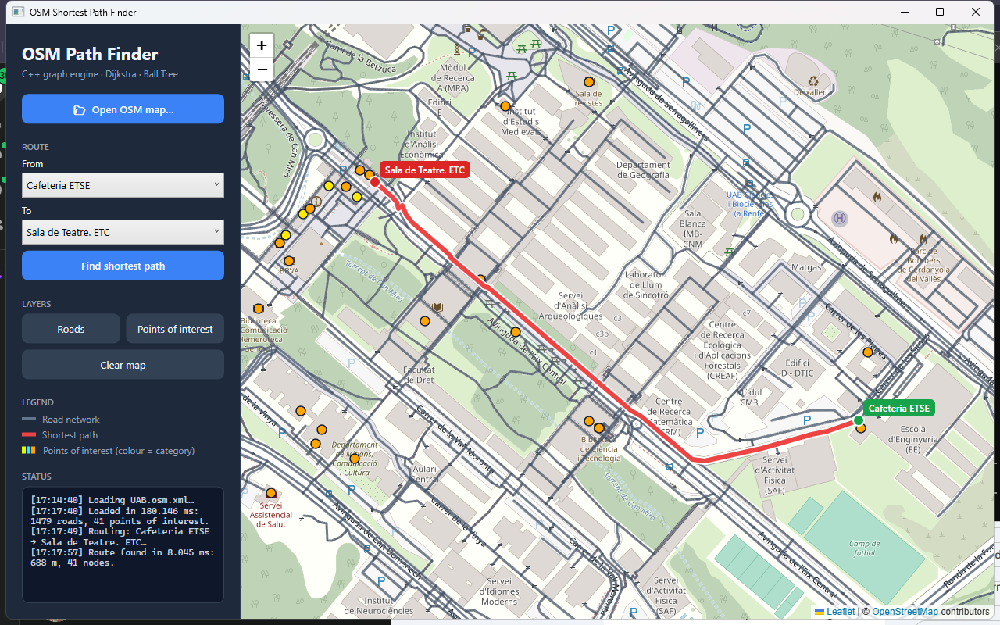
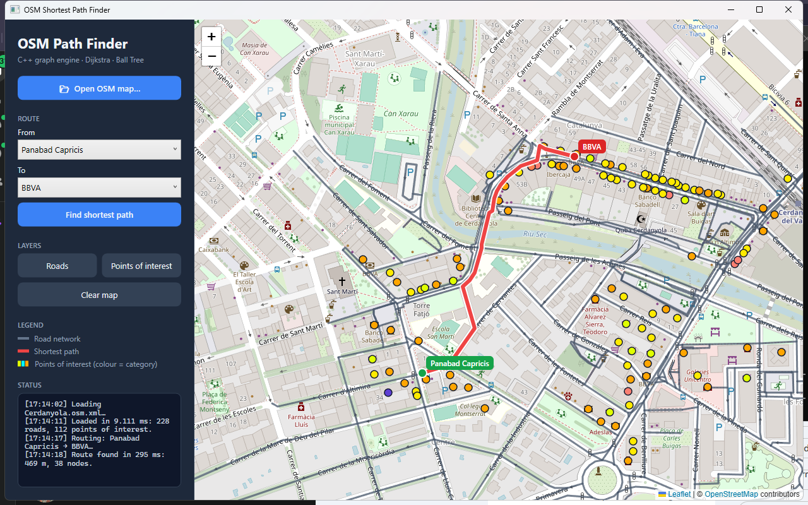
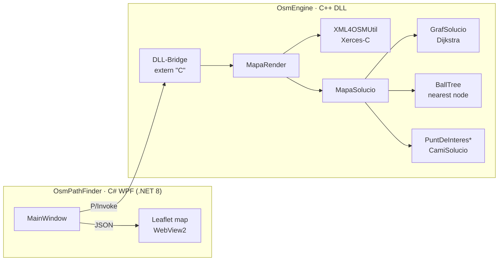

# OSM Shortest Path Finder

Desktop app that loads real **OpenStreetMap** data, builds a road graph and finds the **shortest walking route between two points of interest**. The graph engine is written in **C++** and runs as a native DLL. The interface is **C# / WPF**, with the map drawn by **Leaflet** inside WebView2.



<p align="center"><em>Route from the ETSE cafeteria to the theatre on the UAB campus (1,479 roads loaded from <code>maps/UAB.osm.xml</code>).</em></p>

---

## Features

- **Parses raw `.osm.xml` files** with Xerces-C and extracts the road network (`highway=*`) and named points of interest (shops, restaurants, amenities).
- **Builds a weighted graph.** Edge weights are real distances computed with the **Haversine** formula.
- **Snaps each point of interest to the nearest road node** using a **Ball Tree** spatial index implemented from scratch.
- **Finds the shortest route with Dijkstra's algorithm** and draws it on the map, showing its length and number of nodes.
- **Colours points of interest by category,** using polymorphic `PuntDeInteres*` classes (supermarket, bakery, pizza, Chinese food…).
- **Keeps the UI responsive.** Map loading and routing run on background threads.



## Architecture



| Layer | Responsibility |
|---|---|
| `OsmEngine/MapaSolucio` | Turns XML elements into points of interest and roads, then builds the Ball Tree and the graph |
| `OsmEngine/GrafSolucio` | Graph stored as an adjacency matrix: node lookup, Dijkstra, path reconstruction |
| `OsmEngine/BallTree` | Recursive space partitioning (pivot + radius) for nearest-neighbour queries |
| `OsmEngine/PuntDeInteres*` | Class hierarchy for points of interest, with a colour per category |
| `OsmEngine/DLL-Bridge` | C ABI exposed to .NET (`loadOSMData`, `renderPois`, `renderWays`, `shortestPath`) |
| `OsmPathFinder/` | WPF window, P/Invoke calls, background workers, Leaflet map (`web/map.html`) |

## How the route is computed

1. **Parse.** Every `<node>` is stored with its coordinates. Every `<way>` tagged `highway` becomes a road, made of the coordinates of its nodes.
2. **Build the graph.** Each distinct road coordinate becomes a vertex. Consecutive points on a road are connected by an undirected edge weighted by Haversine distance.
3. **Snap.** Points of interest are usually not on a road, so the Ball Tree finds the road node closest to the origin and to the destination. It prunes any ball whose `distance(pivot) − radius` is already greater than the best distance found.
4. **Route.** Dijkstra runs from the origin node, and the path is rebuilt backwards with the `previous[]` array.

## Build & run

**Requirements:** Windows 10/11 x64, Visual Studio 2022 (or Build Tools) with the *Desktop development with C++* and *.NET desktop* workloads, the .NET 8 SDK, and the WebView2 Runtime (already included in Windows 11).

```powershell
git clone https://github.com/lukasomoza/osm-shortest-path-finder.git
cd osm-shortest-path-finder
msbuild OsmPathFinder.sln /restore /p:Configuration=Release /p:Platform=x64
.\bin\x64\Release\OsmPathFinder.exe
```

You can also open `OsmPathFinder.sln` in Visual Studio, pick **x64**, set **OsmPathFinder** as the startup project and press **F5**. Then click **Open OSM map…** and choose a file from `maps/`.

| Sample map | Roads | Points of interest | Load time* |
|---|---|---|---|
| `Petit.osm.xml` | 6 | 0 | < 1 s |
| `Cerdanyola.osm.xml` | 228 | 112 | ~9 s |
| `UAB.osm.xml` | 1,479 | 41 | ~2.5 min |

<sub>*Measured on a laptop with the Release build. Routing takes under 1 s on Cerdanyola and about 8 s on UAB.</sub>

## Known limitations and next steps

The current implementation favours clarity over performance, so loading large maps is slow:

- [ ] **Node lookup is O(N·M).** Each road reference is matched by scanning every node. A `std::unordered_map<id, Coordinate>` would make it O(1).
- [ ] **Road deduplication is O(N²).** `cercaNodeCamiGuardat` and `GrafSolucio::cerca` do linear searches. A hash map from coordinate to index would avoid them.
- [ ] **The adjacency matrix uses O(V²) memory.** That is about 1 GB for the UAB map. An adjacency list would bring it down to O(V + E).
- [ ] **Dijkstra runs in O(V²).** A `std::priority_queue` would make it O((V + E) log V).
- [ ] **Bridge memory is never freed.** Objects created with `new` (points of interest, roads, Ball Tree nodes) should use `std::unique_ptr`.

## Credits

This project started as a **team project** for the **Laboratori de Programació** course (Computer Engineering, Universitat Autònoma de Barcelona, 2025-26).

- **Provided by the course:** the interface base classes (`MapaBase`, `CamiBase`, `PuntDeInteresBase`), the DLL bridge (`DLL-Bridge`, `MapaRender`), the Xerces-C wrapper (`XML4OSMUtil`) and the original WPF shell.
- **Implemented by the team:** `MapaSolucio`, `GrafSolucio`, `BallTree`, `CamiSolucio`, `PuntDeInteresBotigaSolucio`, `PuntDeInteresRestaurantSolucio` and the helper functions in `Util`.
- **Rebuilt after the course:** the front-end, with a new WPF UI, Leaflet/WebView2 instead of the deprecated UWP `MapControl`, a migration from .NET Core 3.1 to .NET 8, and route distance and timing.

Third-party components:
- [Xerces-C++ 3.2](https://xerces.apache.org/xerces-c/), Apache License 2.0, bundled in `third-party/`.
- [Leaflet](https://leafletjs.com/), BSD-2-Clause.
- Map data and tiles © [OpenStreetMap](https://www.openstreetmap.org/copyright) contributors, ODbL.

---

### 🇪🇸 Resumen en español

Aplicación de escritorio que carga mapas reales de **OpenStreetMap** y calcula la **ruta más corta entre dos puntos de interés**. El motor está en **C++** (DLL nativa) y la interfaz en **C# / WPF**, con el mapa dibujado con Leaflet.

Algoritmos implementados:
- Un **grafo ponderado** con distancia Haversine entre puntos.
- Un **Ball Tree** que encuentra el nodo de carretera más cercano a cada punto de interés.
- **Dijkstra** para calcular la ruta.

Es un proyecto en grupo de la asignatura *Laboratori de Programació* (Ingeniería Informática, UAB).
